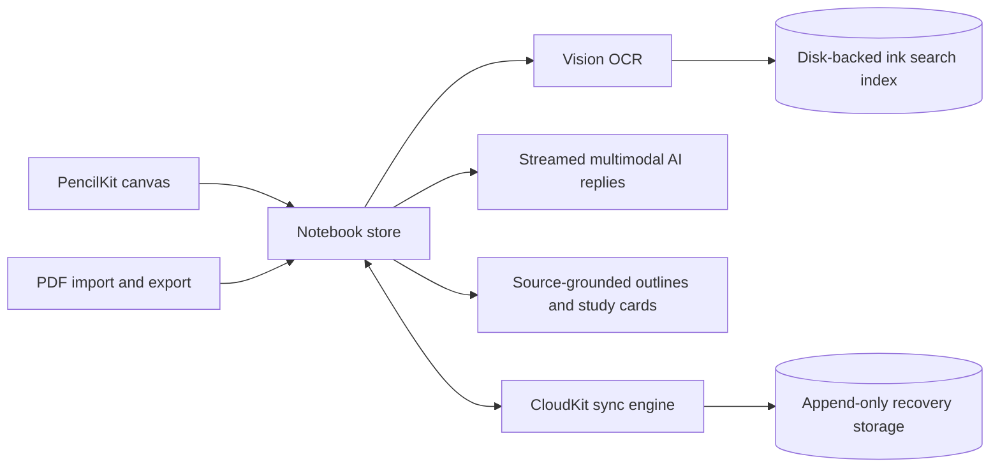

# NoteFun: Handwritten Notebook for iOS with AI

NoteFun is a SwiftUI notebook app for Apple Pencil with searchable handwriting, PDF import and export, AI replies grounded in your pages, and CloudKit sync.

**Status:** in development. No release, user counts or OCR accuracy figures are claimed.

> Source code is private. This repository is a README-only architecture write-up. Happy to walk through the code live: [adk08644@gmail.com](mailto:adk08644@gmail.com).

## Problem

Handwritten notes are hard to search, and syncing them across devices risks silently overwriting one version with another.

## Architecture

## Key engineering decisions

**Searchable ink.** Vision OCR over handwriting feeds a disk-backed search index; PDF text provides additional context.

**Sync that keeps conflicting versions.** CloudKit synchronization is coordinated by an actor, validates local snapshots, and writes to append-only recovery storage so conflicting page versions are preserved instead of overwritten.

**Grounded AI.** Page outlines are generated from the notebook's own content, and study cards use typed generation. The server endpoint parses requests with bounded limits, and notebooks have privacy access controls.

## Tech stack

Swift, SwiftUI, PencilKit, Vision, CloudKit, TypeScript (Supabase edge function).
